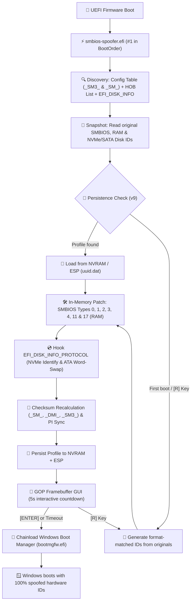

# <p align="center">⚡ EFI SMBIOS & Disk Spoofer — Rust Bare-Metal Edition</p>

<p align="center">
  <strong>Next-Generation UEFI In-Memory Hardware Identifier Engine & Automated Bootloader</strong><br>
  <em>Written in pure <code>no_std</code> Rust with GOP Framebuffer GUI, SMBIOS 3.0 64-bit, Type 17 DDR4/DDR5 RAM & NVMe/SATA Disk Spoofing.</em>
</p>

<p align="center">
  <a href="https://github.com/7ShIkI3/smbios-spoofer-rs/releases"></a>
  <a href="https://rust-lang.org"></a>
  <a href="https://uefi.org"></a>
  <a href="https://github.com/7ShIkI3/smbios-spoofer-rs/actions"></a>
  <a href="LICENSE"></a>
</p>

---

<p align="center">
  
</p>

---

## 🌟 Overview

**EFI SMBIOS Spoofer (`smbios-spoofer-rs`)** is a high-performance bare-metal UEFI application that intercepts and patches system hardware tables and storage controller identify buffers directly in physical memory **before** Windows Boot Manager (`bootmgfw.efi`) or the Linux kernel executes.

Ported and fundamentally re-engineered from the original C/EDK2 project ([Acrozi/SmbiosChanger](https://github.com/Acrozi/SmbiosChanger)), this version eliminates firmware crashes, supports modern 64-bit SMBIOS 3.0 (`_SM3_`) tables, spoofs DDR4/DDR5 RAM DIMM serials, hooks `EFI_DISK_INFO_PROTOCOL` for NVMe/SATA disk serials, and provides a **100% automated 1-click installer** (`install.bat` / `install.ps1`) that replaces manual EasyUEFI workflows.

> [!IMPORTANT]
> **100% Non-Destructive (Zero On-Disk Partition Modification)**:
> All SMBIOS and NVMe/SATA Disk Identify modifications happen **ephemerally in RAM** during the UEFI DXE/BDS boot phase. Your motherboard SPI flash, RAM SPD EEPROMs, and GPT Partition GUIDs on disk are **never** altered—preventing Windows BCD boot errors (`0xc000000e`) and allowing instant restoration simply by booting normally.

---

## 📸 Visual Gallery — What It Looks Like

### 1. Pre-Boot UEFI GOP Framebuffer Dashboard (`smbios-spoofer.efi`)
When your PC turns on, `smbios-spoofer.efi` runs at `#1` in the UEFI `BootOrder` before Windows loads. It renders directly to the UEFI **Graphics Output Protocol (GOP)** hardware framebuffer (bypassing the AMI Aptio text-mode color bug on ASUS/MSI motherboards):

<p align="center">
  
</p>

- **Left Panel**: Real-time step execution tracker + **Active Engine Status** (`_SM3_` 64-bit, `_SM_` 32-bit, Entry Checksums, `EFI_DISK_INFO` Hook, `EFI_SMBIOS_PROTOCOL` sync, and target OS `bootmgfw.efi`).
- **Right Panel**: Side-by-side comparison (`orig -> new`) of every hardware identifier, captured **before** patching so you always see your true hardware baseline vs. the active spoofed profile.
- **Interactive Bottom Bar**: 5-second auto-boot countdown. Press **`[ENTER]` / `[S]`** to boot Windows immediately, **`[R]`** to generate and persist a brand-new hardware identity on the fly, or **`[P]`** to pause/resume the countdown.

---

### 2. One-Click Automated Windows Installer (`.\install.ps1`)
No paid EasyUEFI software or manual USB partition mounting required. Running `install.bat` (or `.\install.ps1` as Administrator) compiles the UEFI binary, runs all **127 unit tests**, mounts the EFI System Partition (`mountvol /S`), deploys `\EFI\SmbiosSpoofer\smbios-spoofer.efi`, and registers it at position `#1` in `{fwbootmgr}` via `bcdedit`:

<p align="center">
  
</p>

---

### 3. Post-Boot Windows WMI / CIM Verification (`.\install.ps1 -Mode status`)
Once Windows boots, run `.\install.ps1 -Mode status` to compare active Windows WMI/CIM hardware identifiers against the pre-spoof snapshot (`smbios-snapshot-before.json`) and inspect your EFI System Partition (`uuid.dat` `v9`):

<p align="center">
  
</p>

---

## 🚀 Comparison: Original C vs. Rust Bare-Metal Edition

| Capability | Original C/EDK2 ([Acrozi](https://github.com/Acrozi/SmbiosChanger)) | `smbios-spoofer-rs` (`v0.2.0`) |
| :--- | :---: | :---: |
| **Language & Safety** | C / EDK2 (raw pointer arithmetic) | **Rust 2024 (`no_std`, `uefi 0.39`)** |
| **Installation** | ❌ Manual (requires paid/third-party EasyUEFI) | **✅ 100% Automated (`install.bat` / `install.ps1`)** |
| **SMBIOS 3.0 (64-bit `_SM3_`)** | ❌ Unhandled (casts 64-bit table to 32-bit `_SM_`) | **✅ Full 64-bit Entry Point & Dual-Table Patching** |
| **RAM DIMM Spoofing (Type 17)** | ❌ None | **✅ Deterministic per-slot RAM serial & asset tags** |
| **Battery & PSU (Type 22 / 39)** | ❌ None | **✅ Laptop Battery (`SBDS` + Serial) & PSU Serial/AssetTag** |
| **NVMe / SATA Disk Spoofing** | ❌ None | **✅ `EFI_DISK_INFO` + `EFI_NVM_EXPRESS_PASS_THRU` Admin Identify hooks** |
| **String Table Preservation** | ⚠️ Can overwrite with `\0\0` and truncate table | **✅ Byte-safe in-place padding (zero corruption)** |
| **UUID Wire Format** | ⚠️ Big-endian string cast | **✅ SMBIOS 2.6+ Mixed-Endian RFC 4122 standard** |
| **`EFI_SMBIOS_PROTOCOL`** | ❌ None (raw memory only) | **✅ Full PI/DXE FFI protocol sync** |
| **Windows Chainloading** | ❌ Relies on BIOS BootOrder fallback | **✅ Native `bootmgfw.efi` launch with `DevicePath`** |
| **AMI Aptio Display Bug** | ❌ Text colors ignored (monochrome/gray) | **✅ GOP Framebuffer GUI (RGBx & BGRx auto-detect)** |
| **Persistence Engine** | ⚠️ Single volume only | **✅ Multi-volume ESP scan (`\EFI\SmbiosSpoofer\uuid.dat` v9)** |
| **Unit Test Suite & CI** | ❌ None | **✅ 128 Host & Integration Tests + GitHub Actions CI** |

---

## 🔄 Boot Sequence & Architecture



---

## 🛡️ Comprehensive Spoofed Identifiers

| Identifier | Protocol / Type | Offset | Method & Format |
| :--- | :---: | :---: | :--- |
| **BIOS Vendor** | SMBIOS Type 0 | `0x04` | Preserves valid vendor or replaces in-place (AMI, Insyde) |
| **BIOS Version** | SMBIOS Type 0 | `0x05` | Format-matched revision (e.g. `FX707ZM.315` → `FX707ZM.368`) |
| **BIOS Release Date** | SMBIOS Type 0 | `0x08` | Validated `MM/DD/YYYY` realistic calendar date |
| **System UUID** | SMBIOS Type 1 | `0x08..0x17` | RFC 4122 v4 UUID in **SMBIOS 2.6+ mixed-endian** wire format |
| **System Serial** | SMBIOS Type 1 | `0x07` | Vendor-aware format matching (Dell, Lenovo, HP, ASUS, MSI) |
| **System SKU Number** | SMBIOS Type 1 | `0x19` | Alphanumeric SKU format-matched replacement |
| **Baseboard Serial** | SMBIOS Type 2 | `0x07` | Motherboard serial replacement matching manufacturer pattern |
| **Baseboard Asset Tag**| SMBIOS Type 2 | `0x08` | Chassis/board asset tag replacement |
| **Chassis Serial** | SMBIOS Type 3 | `0x07` | Enclosure serial replacement |
| **Chassis Asset Tag** | SMBIOS Type 3 | `0x08` | Enclosure asset tag replacement (removes placeholder tags) |
| **Processor Serial** | SMBIOS Type 4 | `0x20` | CPU socket serial spoofing across all physical cores/sockets |
| **Processor Asset Tag**| SMBIOS Type 4 | `0x21` | Processor asset identifier |
| **OEM Strings** | SMBIOS Type 11 | Variable | Deterministic per-profile obfuscation (preserves punctuation) |
| **RAM DIMM Serials** | SMBIOS Type 17 | `0x18` | **Deterministic per-slot DDR4/DDR5 serials** (e.g. Hynix, Kingston, Corsair) |
| **RAM DIMM Asset Tags**| SMBIOS Type 17 | `0x19` | Memory module asset tags |
| **Portable Battery** | SMBIOS Type 22 | `0x07 / 0x10` | Laptop battery serial string + 16-bit binary `SBDS` serial |
| **System Power Supply**| SMBIOS Type 39 | `0x08 / 0x09` | PSU serial number & asset tag |
| **NVMe Disk Serial** | `EFI_DISK_INFO` + `NVME_PASS_THRU` | `4..24` | 4096-byte `NVMe Identify Controller` `SN` (protocol hook + Admin `PassThru` + DXE page patch) |
| **SATA / AHCI Disk Serial**| `EFI_DISK_INFO` | `20..40` | 512-byte `ATA IDENTIFY DEVICE` words `10..19` (**word-swapped ASCII**) |
| **SCSI / USB Inquiry** | `EFI_DISK_INFO` | `36..56` | Extended `SCSI INQUIRY` vendor-specific serial patch |
| **Network MAC Address**| SNP / NVRAM | — | Locally administered unicast MAC (`StationAddress` + `SimpleNetworkMode` RAM patch) |

---

## ⚡ Quick Start: 1-Click Automated Installation

### 1. Prerequisites
- **Disable Secure Boot** in your motherboard BIOS/UEFI settings.
- Windows 10/11 running in **UEFI Mode** (GPT partition style).

### 2. Automatic Install (Recommended)
Right-click on **`install.bat`** and select **Run as Administrator** (or execute from an elevated PowerShell):

```powershell
# 1-Click: Verifies Rust, runs 125 tests, builds .efi, copies to ESP, and sets BootOrder #1
.\install.ps1
```

> [!TIP]
> **Optional Build Flags**:
> - `.\install.ps1 -SpoofMac` : Includes network interface MAC address spoofing.
> - `.\install.ps1 -Headless -SpoofMac` : **Ultra-stealth mode** (<100ms boot, zero display output).
> - `.\install.ps1 -Mode install-only` : Fast deploy to ESP if `smbios-spoofer.efi` is already compiled.

### 3. Reboot & Enjoy
Reboot your computer. The spoofer will automatically execute before Windows, display the GOP configuration dashboard, and chainload Windows Boot Manager seamlessly.

### 4. Post-Boot Verification
After logging back into Windows, verify that all hardware identifiers have changed:

```powershell
.\install.ps1 -Mode status
```

---

## 💻 CLI & Installer Options

The included [`install.ps1`](install.ps1) script provides an end-to-end management toolkit:

```powershell
Syntax: .\install.ps1 [-Mode <install|status|build-only|install-only|reset-profile|uninstall>]
                      [-Headless] [-SpoofMac] [-SkipTests] [-UsbDrive <DriveLetter>]
```

| Mode / Flag | Purpose |
| :--- | :--- |
| `-Mode install` *(default)* | Full end-to-end flow: compiles, mounts ESP, deploys binary, and registers `{fwbootmgr}` entry. |
| `-Mode status` | Inspects current Windows WMI/CIM SMBIOS + Disk identifiers and compares against pre-spoof baseline. |
| `-Mode build-only` | Executes all 128 unit tests and compiles `target\x86_64-unknown-uefi\release\smbios-spoofer.efi`. |
| `-Mode install-only` | Deploys an already-built `.efi` file to the ESP and configures `bcdedit`. |
| `-Mode reset-profile` | Deletes `\EFI\SmbiosSpoofer\uuid.dat` on the ESP to force new randomized IDs on next boot. |
| `-Mode backup-profile`| Exports `\EFI\SmbiosSpoofer\uuid.dat` from the ESP to `profile-backup.dat`. |
| `-Mode restore-profile`| Restores `profile-backup.dat` back to `\EFI\SmbiosSpoofer\uuid.dat` on the ESP. |
| `-Mode uninstall` | Deletes the UEFI boot entry from `bcdedit` and removes all spoofer files from the ESP. |
| `-UsbDrive E:` | Installs the spoofer to a USB flash drive (`E:\EFI\BOOT\BOOTX64.EFI`) for portable use. |

---

## 🛠️ Manual Compilation & Testing

```bash
# 1. Add UEFI cross-compilation target
rustup target add x86_64-unknown-uefi

# 2. Run all unit & integration tests on host (125 tests)
cargo test --target x86_64-pc-windows-msvc

# 3. Check code formatting and linter
cargo clippy --target x86_64-unknown-uefi -- -D warnings

# 4. Build optimized release binary (includes NVMe/SATA disk spoofing by default)
cargo build --release --target x86_64-unknown-uefi

# 5. Build with optional features
cargo build --release --target x86_64-unknown-uefi --features "spoof-mac"
cargo build --release --target x86_64-unknown-uefi --features "headless,spoof-mac"
```

---

## 📂 Project Structure

```
smbios-spoofer-rs/
├── .cargo/
│   └── config.toml          # Custom target configs & compiler optimization flags
├── images/
│   ├── spoof.png            # Side-by-side Hero Banner (UEFI GOP GUI + Windows Verification)
│   ├── uefi-dashboard.png   # Pixel-accurate UEFI GOP Framebuffer GUI screenshot
│   ├── installer-flow.png   # 1-Click PowerShell Automated Installer screenshot
│   └── windows-status.png   # Post-Boot WMI/CIM Status Comparison screenshot
├── src/
│   ├── main.rs              # UEFI entry point, pre-patch original capture & Windows chainloader
│   ├── gfx.rs               # GOP framebuffer graphics engine (auto-detects RGBx/BGRx format)
│   ├── smbios.rs            # #[repr(C, packed)] SMBIOS 2.x/3.0 structures & safe edit_string
│   ├── finder.rs            # Dual-table discovery via UEFI Config Table & PI/DXE HOB List
│   ├── patch.rs             # In-memory table modification engine & checksum recalculation
│   ├── persistence.rs       # Multi-volume ESP persistence (uuid.dat v9) & NVRAM variable engine
│   ├── utils.rs             # Hardware TSC/RTC RNG, RFC 4122 mixed-endian UUID & vendor logic
│   ├── spoof_disk.rs        # NVMe / SATA / SCSI disk serial spoofer via EFI_DISK_INFO_PROTOCOL
│   ├── spoof_net.rs         # Optional MAC address spoofer via UEFI SNP protocol
│   └── agentic.rs           # Optional autonomous decision engine (gated behind feature flag)
├── tests/
│   └── utils_tests.rs       # Host test harness verifying format-matching and UUID encoding
├── install.bat              # 1-Click double-clickable Windows launcher with automatic UAC elevation
├── install.ps1              # Core PowerShell automation engine (ESP mountvol + bcdedit)
├── install.sh               # Cross-platform deployment script for Windows & Linux
├── README.md                # Project documentation
└── Cargo.toml               # Package manifest and dependencies
```

---

## ❓ Frequently Asked Questions (FAQ)

<details>
<summary><strong>Does this permanently change my motherboard or SSD serials?</strong></summary>
<p>No. All SMBIOS tables and <code>EFI_DISK_INFO_PROTOCOL</code> buffers are modified exclusively in system RAM while UEFI Boot Services are active. When you power off your computer, RAM is cleared. The next time you boot without the spoofer, your factory hardware serials remain 100% intact.</p>
</details>

<details>
<summary><strong>How does Disk Spoofing avoid breaking Windows Boot Manager (0xc000000e)?</strong></summary>
<p>Naive disk spoofers overwrite the on-disk GPT Partition GUIDs, which immediately breaks the Windows Boot Configuration Data (<code>\EFI\Microsoft\Boot\BCD</code>) because Windows locates <code>winload.efi</code> by partition GUID. Instead, <code>src/spoof_disk.rs</code> leaves on-disk GPT headers untouched and intercepts <code>EFI_DISK_INFO_PROTOCOL.Identify</code> / <code>Inquiry</code> in RAM, spoofing the 20-byte NVMe Controller Serial Number (bytes <code>4..24</code>) and ATA word-swapped Serial Number (words <code>10..19</code>) safely.</p>
</details>

<details>
<summary><strong>Why does the installer eliminate EasyUEFI?</strong></summary>
<p>EasyUEFI is a third-party paid utility. <code>install.ps1</code> uses native Windows tools (<code>mountvol /S</code> and <code>bcdedit /copy "{bootmgr}"</code>) to mount the EFI System Partition and place <code>smbios-spoofer.efi</code> directly in position #1 of the firmware boot order (<code>{fwbootmgr}</code>) natively and automatically.</p>
</details>

---

## 📜 License & Credits

Distributed under the **MIT License**. See [`LICENSE`](LICENSE) for more information.

- Original C concept: [Acrozi/SmbiosChanger](https://github.com/Acrozi/SmbiosChanger)
- Rust UEFI abstraction: [rust-osdev/uefi-rs](https://github.com/rust-osdev/uefi-rs)
- 8×8 Bitmap Font: Public Domain
