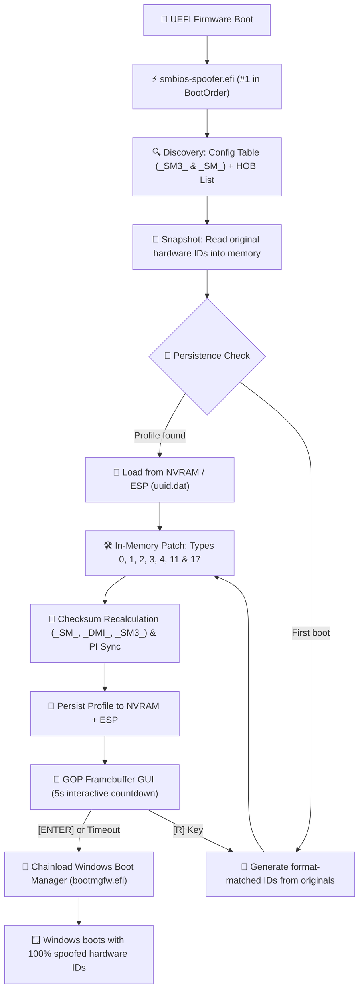

# <p align="center">⚡ EFI SMBIOS Spoofer — Rust Bare-Metal Edition</p>

<p align="center">
  <strong>Next-Generation UEFI In-Memory Hardware Identifier Engine & Automated Bootloader</strong><br>
  <em>Written in pure <code>no_std</code> Rust with GOP Framebuffer GUI, SMBIOS 3.0 64-bit & Type 17 RAM support.</em>
</p>

<p align="center">
  <a href="https://github.com/7ShIkI3/smbios-spoofer-rs/releases"></a>
  <a href="https://rust-lang.org"></a>
  <a href="https://uefi.org"></a>
  <a href="https://github.com/7ShIkI3/smbios-spoofer-rs/actions"></a>
  <a href="LICENSE"></a>
</p>

---

<p align="center">
  
</p>

---

## 🌟 Overview

**EFI SMBIOS Spoofer** is a high-performance bare-metal UEFI application that intercepts and patches system hardware tables directly in physical memory **before** Windows Boot Manager or the Linux kernel executes.

Ported and fundamentally re-engineered from the original C/EDK2 project ([Acrozi/SmbiosChanger](https://github.com/Acrozi/SmbiosChanger)), this version is designed from the ground up to eliminate firmware crashes, support modern 64-bit SMBIOS 3.0 tables, spoof DDR4/DDR5 RAM DIMM serials, and provide a **100% automated installation experience** that completely replaces manual EasyUEFI procedures.

> [!IMPORTANT]
> **Zero Disk Signature Alteration**: All SMBIOS table modifications happen **ephemerally in RAM** at boot time. Your motherboard BIOS and hardware EEPROMs are never flashed or permanently modified. Reverting is as simple as booting normally.

---

## 🚀 Comparison: Original C vs. Rust Bare-Metal Edition

| Capability | Original C/EDK2 ([Acrozi](https://github.com/Acrozi/SmbiosChanger)) | `smbios-spoofer-rs` (`v0.2.0`) |
| :--- | :---: | :---: |
| **Language & Safety** | C / EDK2 (raw pointer arithmetic) | **Rust 2024 (`no_std`, `uefi 0.39`)** |
| **Installation** | ❌ Manual (requires paid/third-party EasyUEFI) | **✅ 100% Automated (`install.bat` / `install.ps1`)** |
| **SMBIOS 3.0 (64-bit `_SM3_`)** | ❌ Unhandled (casts 64-bit table to 32-bit `_SM_`) | **✅ Full 64-bit Entry Point & Dual-Table Patching** |
| **RAM DIMM Spoofing (Type 17)** | ❌ None | **✅ Deterministic per-slot RAM serial & asset tags** |
| **String Table Preservation** | ⚠️ Can overwrite with `\0\0` and truncate table | **✅ Byte-safe in-place padding (zero corruption)** |
| **UUID Wire Format** | ⚠️ Big-endian string cast | **✅ SMBIOS 2.6+ Mixed-Endian RFC 4122 standard** |
| **`EFI_SMBIOS_PROTOCOL`** | ❌ None (raw memory only) | **✅ Full PI/DXE FFI protocol sync** |
| **Windows Chainloading** | ❌ Relies on BIOS BootOrder fallback | **✅ Native `bootmgfw.efi` launch with `DevicePath`** |
| **AMI Aptio Display Bug** | ❌ Text colors ignored (monochrome/gray) | **✅ GOP Framebuffer GUI (RGBx & BGRx auto-detect)** |
| **Persistence Engine** | ⚠️ Single volume only | **✅ Multi-volume ESP scan (`\EFI\SmbiosSpoofer\uuid.dat`)** |
| **Unit Test Suite** | ❌ None | **✅ 121 Host & Integration Tests passing** |

---

## 🔄 Boot Sequence & Architecture



---

## 🛡️ Comprehensive Spoofed Identifiers

| Identifier | SMBIOS Type | Offset | Method & Format |
| :--- | :---: | :---: | :--- |
| **BIOS Vendor** | Type 0 | `0x04` | Format-matched in-place replacement (e.g. AMI, Insyde) |
| **BIOS Version** | Type 0 | `0x05` | Format-matched revision (e.g. `FX707ZM.315` → `FX707ZM.318`) |
| **BIOS Release Date** | Type 0 | `0x08` | Validated `MM/DD/YYYY` realistic calendar date |
| **System UUID** | Type 1 | `0x08..0x17` | RFC 4122 v4 UUID in **SMBIOS 2.6+ mixed-endian** wire format |
| **System Serial** | Type 1 | `0x07` | Vendor-aware format matching (Dell, Lenovo, HP, ASUS, etc.) |
| **System SKU Number** | Type 1 | `0x19` | Alphanumeric SKU format-matched replacement |
| **Baseboard Serial** | Type 2 | `0x07` | Motherboard serial replacement matching manufacturer pattern |
| **Baseboard Asset Tag**| Type 2 | `0x08` | Chassis/board asset tag replacement |
| **Chassis Serial** | Type 3 | `0x07` | Enclosure serial replacement |
| **Chassis Asset Tag** | Type 3 | `0x08` | Enclosure asset tag replacement (removes placeholder tags) |
| **Processor Serial** | Type 4 | `0x20` | CPU socket serial spoofing across all physical cores/sockets |
| **Processor Asset Tag**| Type 4 | `0x21` | Processor asset identifier |
| **OEM Strings** | Type 11 | Variable | Deterministic per-profile obfuscation (preserves punctuation) |
| **RAM DIMM Serials** | Type 17 | `0x18` | **Deterministic per-slot DDR4/DDR5 serials** (e.g. Kingston, Corsair) |
| **RAM DIMM Asset Tags**| Type 17 | `0x19` | Memory module asset tags |
| **Network MAC Address**| SNP / NVRAM | — | Locally administered unicast MAC (via `--features spoof-mac`) |

---

## ⚡ Quick Start: 1-Click Automated Installation

### 1. Prerequisites
- **Disable Secure Boot** in your motherboard BIOS/UEFI settings.
- Windows 10/11 running in **UEFI Mode** (GPT partition style).

### 2. Automatic Install (Recommended)
Right-click on **`install.bat`** and select **Run as Administrator** (or execute from an elevated PowerShell):

```powershell
# 1-Click: Verifies Rust, runs 121 tests, builds .efi, copies to ESP, and sets BootOrder #1
.\install.ps1
```

> [!TIP]
> **Optional Build Flags**:
> - `.\install.ps1 -SpoofMac` : Includes network interface MAC address spoofing.
> - `.\install.ps1 -Headless -SpoofMac` : **Ultra-stealth mode** (<100ms boot, zero display output).

### 3. Reboot & Enjoy
Reboot your computer. The spoofer will automatically execute before Windows, display the GOP configuration dashboard, and chainload Windows Boot Manager seamlessly.

### 4. Post-Boot Verification
After logging back into Windows, verify that all hardware identifiers have changed:

```powershell
.\install.ps1 -Mode status
```

---

## 💻 CLI & Installer Options

The included [`install.ps1`](install.ps1) script provides an end-to-end management toolkit:

```powershell
Syntax: .\install.ps1 [-Mode <install|status|build-only|install-only|reset-profile|uninstall>]
                      [-Headless] [-SpoofMac] [-SkipTests] [-UsbDrive <DriveLetter>]
```

| Mode / Flag | Purpose |
| :--- | :--- |
| `-Mode install` *(default)* | Full end-to-end flow: compiles, mounts ESP, deploys binary, and registers `{fwbootmgr}` entry. |
| `-Mode status` | Inspects current Windows WMI/CIM SMBIOS identifiers and compares against pre-spoof baseline. |
| `-Mode build-only` | Executes all 121 unit tests and compiles `target\x86_64-unknown-uefi\release\smbios-spoofer.efi`. |
| `-Mode install-only` | Deploys an already-built `.efi` file to the ESP and configures `bcdedit`. |
| `-Mode reset-profile` | Deletes `\EFI\SmbiosSpoofer\uuid.dat` on the ESP to force new randomized IDs on next boot. |
| `-Mode uninstall` | Deletes the UEFI boot entry from `bcdedit` and removes all spoofer files from the ESP. |
| `-UsbDrive E:` | Installs the spoofer to a USB flash drive (`E:\EFI\BOOT\BOOTX64.EFI`) for portable use. |

---

## 🛠️ Manual Compilation & Testing

```bash
# 1. Add UEFI cross-compilation target
rustup target add x86_64-unknown-uefi

# 2. Run all unit & integration tests on host (121 tests)
cargo test --target x86_64-pc-windows-msvc

# 3. Check code formatting and linter
cargo clippy --target x86_64-unknown-uefi -- -D warnings

# 4. Build optimized release binary
cargo build --release --target x86_64-unknown-uefi

# 5. Build with optional features
cargo build --release --target x86_64-unknown-uefi --features "spoof-mac"
cargo build --release --target x86_64-unknown-uefi --features "headless,spoof-mac"
```

---

## 📂 Project Structure

```
smbios-spoofer-rs/
├── .cargo/
│   └── config.toml          # Custom target configs & compiler optimization flags
├── images/
│   └── spoof.png            # Framebuffer GUI preview screenshot
├── src/
│   ├── main.rs              # UEFI entry point, pre-patch original capture & Windows chainloader
│   ├── gfx.rs               # GOP framebuffer graphics engine (auto-detects RGBx/BGRx format)
│   ├── smbios.rs            # #[repr(C, packed)] SMBIOS 2.x/3.0 structures & safe edit_string
│   ├── finder.rs            # Dual-table discovery via UEFI Config Table & PI/DXE HOB List
│   ├── patch.rs             # In-memory table modification engine & checksum recalculation
│   ├── persistence.rs       # Multi-volume ESP persistence (uuid.dat) & NVRAM variable engine
│   ├── utils.rs             # Hardware TSC/RTC RNG, RFC 4122 mixed-endian UUID & vendor logic
│   ├── spoof_net.rs         # Optional MAC address spoofer via UEFI SNP protocol
│   └── agentic.rs           # Optional autonomous decision engine (gated behind feature flag)
├── tests/
│   └── utils_tests.rs       # Host test harness verifying format-matching and UUID encoding
├── install.bat              # 1-Click double-clickable Windows launcher with automatic UAC elevation
├── install.ps1              # Core PowerShell automation engine (ESP mountvol + bcdedit)
├── install.sh               # Cross-platform deployment script for Windows & Linux
├── README.md                # Project documentation
└── Cargo.toml               # Package manifest and dependencies
```

---

## ❓ Frequently Asked Questions (FAQ)

<details>
<summary><strong>Does this permanently change my motherboard serials?</strong></summary>
<p>No. All SMBIOS tables are modified exclusively in system RAM while UEFI Boot Services are active. When you power off your computer, RAM is cleared. The next time you boot without the spoofer, your factory hardware serials remain 100% intact.</p>
</details>

<details>
<summary><strong>Do my games or anti-cheats detect this?</strong></summary>
<p>Because the spoofer runs before Windows loads, Windows and any user-mode or kernel-mode software (ring 0 drivers) read the spoofed values as if they were supplied directly by the motherboard firmware. All Entry Point checksums (<code>_SM_</code>, <code>_DMI_</code>, <code>_SM3_</code>) and structure terminators are recalculated to be 100% specification-compliant.</p>
</details>

<details>
<summary><strong>Why does the installer eliminate EasyUEFI?</strong></summary>
<p>EasyUEFI is a third-party paid utility. <code>install.ps1</code> uses native Windows tools (<code>mountvol /S</code> and <code>bcdedit /copy "{bootmgr}"</code>) to mount the EFI System Partition and place <code>smbios-spoofer.efi</code> directly in position #1 of the firmware boot order (<code>{fwbootmgr}</code>) natively and automatically.</p>
</details>

---

## 📜 License & Credits

Distributed under the **MIT License**. See [`LICENSE`](LICENSE) for more information.

- Original C concept: [Acrozi/SmbiosChanger](https://github.com/Acrozi/SmbiosChanger)
- Rust UEFI abstraction: [rust-osdev/uefi-rs](https://github.com/rust-osdev/uefi-rs)
- 8×8 Bitmap Font: Public Domain
