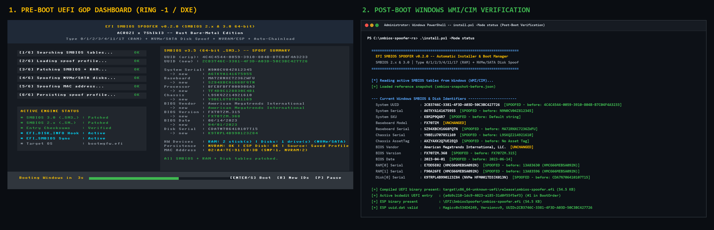
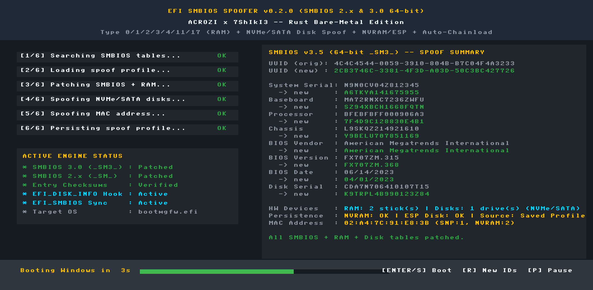
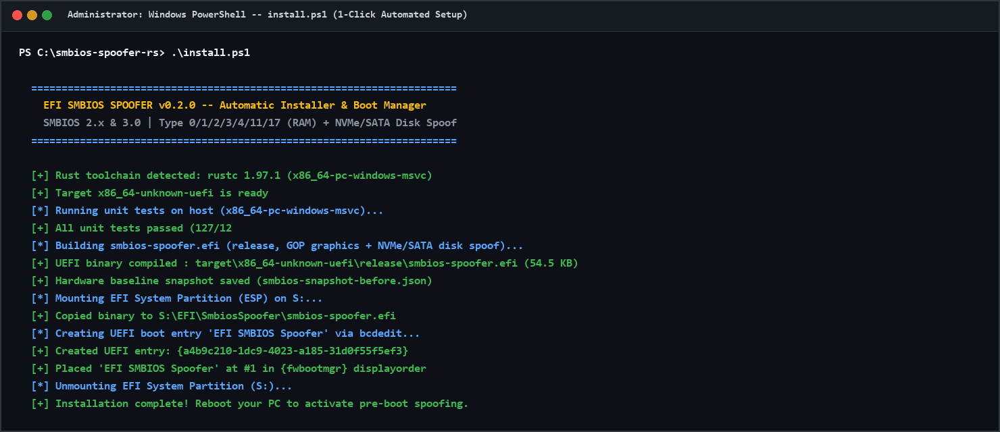
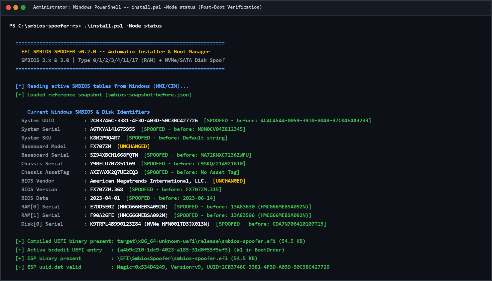
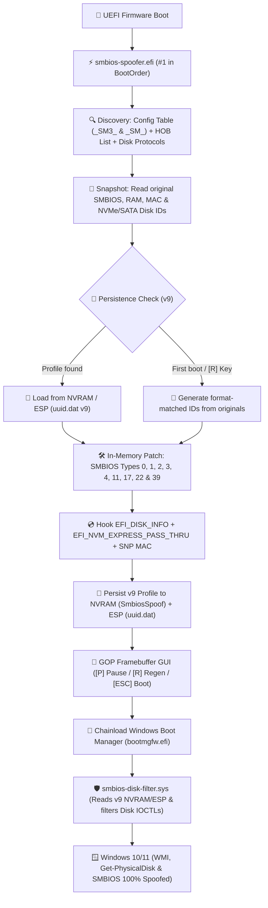

# <p align="center">⚡ EFI SMBIOS & Disk Spoofer — Rust Bare-Metal + Ring 0 Edition</p>

<p align="center">
  <strong>Next-Generation UEFI In-Memory Hardware Identifier Engine & Windows WDM Storage Filter Driver</strong><br>
  <em>Written in pure <code>no_std</code> Rust with GOP Framebuffer GUI, SMBIOS 3.0 64-bit, Type 17 DDR4/DDR5 RAM & Dual-Stage NVMe/SATA Disk Spoofing (UEFI + Windows Ring 0).</em>
</p>

<p align="center">
  <a href="https://github.com/7ShIkI3/smbios-spoofer-rs/releases"></a>
  <a href="https://rust-lang.org"></a>
  <a href="https://uefi.org"></a>
  <a href="https://github.com/7ShIkI3/smbios-spoofer-rs/actions"></a>
  <a href="LICENSE"></a>
</p>

---

<p align="center">
  
</p>

---

## 🌟 Overview

**EFI SMBIOS Spoofer (`smbios-spoofer-rs`)** is a high-performance bare-metal UEFI application (`smbios-spoofer.efi`) paired with a lightweight Windows Kernel WDM Storage Filter Driver (`smbios-disk-filter.sys`) written in 100% `#![no_std]` Rust. Together, they intercept and patch system hardware tables and NVMe/SATA/SCSI storage controller identify buffers across both the **pre-boot UEFI phase** and **post-boot Windows kernel runtime**.

Ported and fundamentally re-engineered from the original C/EDK2 project ([Acrozi/SmbiosChanger](https://github.com/Acrozi/SmbiosChanger)), this version eliminates firmware crashes, supports modern 64-bit SMBIOS 3.0 (`_SM3_`) tables, spoofs DDR4/DDR5 RAM DIMM serials (Type 17), Laptop Batteries (Type 22), Power Supplies (Type 39), Network MAC addresses, and synchronizes NVMe/SATA disk serials from UEFI (`v9` profile) directly into the Windows Storage Stack (`stornvme.sys` / `disk.sys` / WMI).

> [!IMPORTANT]
> **100% Non-Destructive (Zero On-Disk Partition Modification)**:
> All SMBIOS and NVMe/SATA Disk Identify modifications happen **ephemerally in RAM**. Your motherboard SPI flash, RAM SPD EEPROMs, SSD controller firmware, and GPT Partition GUIDs on disk are **never** altered—preventing Windows BCD boot errors (`0xc000000e`) and `INACCESSIBLE_BOOT_DEVICE` (`0x7B`) crashes.

---

## 📸 Visual Gallery — What It Looks Like

### 1. Pre-Boot UEFI GOP Framebuffer Dashboard (`smbios-spoofer.efi`)
When your PC turns on, `smbios-spoofer.efi` runs at `#1` in the UEFI `BootOrder` before Windows loads. It renders directly to the UEFI **Graphics Output Protocol (GOP)** hardware framebuffer (bypassing the AMI Aptio text-mode color bug on ASUS/MSI motherboards):

<p align="center">
  
</p>

- **Left Panel**: Real-time step execution tracker + **Active Engine Status** (`_SM3_` 64-bit, `_SM_` 32-bit, Entry Checksums, `EFI_DISK_INFO` + `NVME_PASS_THRU` Hooks, `EFI_SMBIOS_PROTOCOL` sync, and target OS `bootmgfw.efi`).
- **Right Panel**: Side-by-side comparison (`orig -> new`) of every hardware identifier, captured **before** patching so you always see your true hardware baseline vs. the active spoofed profile.
- **Interactive Bottom Bar**: 5-second auto-boot countdown. Press **`[ESC]`** to boot Windows immediately, **`[R]`** to generate and persist a brand-new hardware identity on the fly, or **`[P]`** to pause/resume the countdown for inspection.

---

### 2. One-Click Automated Windows Installer (`.\install.ps1`)
No paid EasyUEFI software or external 10 GB Windows Driver Kit (WDK) required. Running `install.bat` (or `.\install.ps1` as Administrator) runs all **132 unit & integration tests**, compiles both `smbios-spoofer.efi` (`60 KB`) and `smbios-disk-filter.sys` (`8.5 KB`), mounts the EFI System Partition (`mountvol /S`), deploys the binaries, and registers the UEFI boot entry at `#1` in `{fwbootmgr}` via `bcdedit`:

<p align="center">
  
</p>

---

### 3. Post-Boot Windows WMI / CIM Verification (`.\install.ps1 -Mode status`)
Once Windows boots, run `.\install.ps1 -Mode status` to compare active Windows WMI/CIM hardware identifiers against the pre-spoof snapshot (`smbios-snapshot-before.json`), inspect your EFI System Partition (`uuid.dat` `v9`), and check the status of the `SmbiosDiskFilter` kernel driver:

<p align="center">
  
</p>

---

## 💿 Dual-Stage NVMe / SATA Disk Spoofing Architecture

Why do standard UEFI-only spoofers fail to change `Get-PhysicalDisk` (`Win32_DiskDrive`) under Windows?
Because once `winload.efi` calls `ExitBootServices()`, UEFI protocols cease to exist and the Windows kernel NVMe miniport driver (**`stornvme.sys`**) resets the PCIe BAR0 MMIO Admin Queue and sends a fresh hardware DMA `Identify Controller` (`Opcode 0x06, CNS 0x01`) command directly to the SSD chip, synthesizing a 30-byte VPD `0x80` serial in the format `[20-byte SN]_[8-hex NSID].` (e.g. `CDA7N706410107T15   _00000001.`).

`smbios-spoofer-rs` solves this with a **Dual-Stage Architecture** synchronized via the `v9` persistence profile:

1. **Stage 1 — UEFI Pre-Boot (`src/spoof_disk.rs`)**:
   - Patches cached DXE `Identify Controller` (4096-byte NVMe) and `IDENTIFY DEVICE` (512-byte ATA word-swapped) buffers in RAM.
   - Hooks `EFI_DISK_INFO_PROTOCOL` (`Identify` & `Inquiry`) and `EFI_NVM_EXPRESS_PASS_THRU_PROTOCOL` (`PassThru` Admin `Opcode 0x06`).
   - Persists the generated 20-byte `disk_serial` and `disk_serial_seed` into UEFI NVRAM (`SmbiosSpoof`, `NV+BS+RT`) and `\EFI\SmbiosSpoofer\uuid.dat` (`v9`).
2. **Stage 2 — Windows Kernel Ring 0 WDM Filter (`driver/src/lib.rs` + `src/win_disk_patch.rs`)**:
   - Compiles into an `8.5 KB` native WDM driver (`smbios-disk-filter.sys`) using standard Rust + MSVC `lib.exe` (`ntoskrnl.def`)—**zero external C++ WDK installation required**.
   - At `DriverEntry`, loads the exact `v9` `disk_serial` from UEFI Runtime NVRAM (`ExGetFirmwareEnvironmentVariable`) or directly from the unmounted ESP partition (`\Device\HarddiskVolume1..8\EFI\SmbiosSpoofer\uuid.dat` via `ZwOpenFile` + `ZwReadFile`).
   - Attaches a Filter Device Object (`FiDO`) to `\Device\Harddisk0\DR0`..`DR7` via `IoAttachDeviceToDeviceStackSafe` as a safe standalone service (`Start = SYSTEM_START`, `ErrorControl = Ignore`—never risks BSOD `0x7B` if `testsigning` is toggled off).
   - Intercepts `IRP_MJ_DEVICE_CONTROL` completion routines for:
     - `IOCTL_STORAGE_QUERY_PROPERTY` (`StorageDeviceProperty`, `StorageDeviceIdProperty` VPD `0x83`, `StorageAdapterProtocolSpecificProperty` / `StorageDeviceProtocolSpecificProperty` 4096-byte NVMe Identify, and `StorageAdapterSerialNumberProperty` UTF-16LE) while preserving `stornvme.sys` `_00000001.` namespace suffixes.
     - `IOCTL_STORAGE_PROTOCOL_COMMAND` (direct NVMe Admin Identify pass-through).
     - `SMART_RCV_DRIVE_DATA` (`SENDCMDOUTPARAMS` 512-byte ATA word-swapped serial).
     - `IOCTL_ATA_PASS_THROUGH` & `IOCTL_SCSI_PASS_THROUGH` (VPD Page `0x80`).

---

## 🚀 Comparison: Original C vs. Rust Bare-Metal + Ring 0 Edition

| Capability | Original C/EDK2 ([Acrozi](https://github.com/Acrozi/SmbiosChanger)) | `smbios-spoofer-rs` (`v0.2.0`) |
| :--- | :---: | :---: |
| **Language & Safety** | C / EDK2 (raw pointer arithmetic) | **Rust (`#![no_std]`, `uefi 0.39` + WDM Ring 0)** |
| **Installation** | ❌ Manual (requires paid/third-party EasyUEFI) | **✅ 100% Automated (`install.bat` / `install.ps1`)** |
| **SMBIOS 3.0 (64-bit `_SM3_`)** | ❌ Unhandled (casts 64-bit table to 32-bit `_SM_`) | **✅ Full 64-bit Entry Point & Dual-Table Patching** |
| **RAM DIMM Spoofing (Type 17)** | ❌ None | **✅ Deterministic per-slot RAM serial & asset tags** |
| **Battery & PSU (Type 22 / 39)** | ❌ None | **✅ Laptop Battery (`SBDS` + Serial) & PSU Serial/AssetTag** |
| **UEFI Pre-Boot Disk Spoofing** | ❌ None | **✅ `EFI_DISK_INFO` + `EFI_NVM_EXPRESS_PASS_THRU` hooks** |
| **Windows Ring 0 Disk Filter** | ❌ None | **✅ `smbios-disk-filter.sys` (NVMe/SATA/SCSI IOCTL patcher)** |
| **String Table Preservation** | ⚠️ Can overwrite with `\0\0` and truncate table | **✅ Byte-safe in-place padding (zero corruption)** |
| **UUID Wire Format** | ⚠️ Big-endian string cast | **✅ SMBIOS 2.6+ Mixed-Endian RFC 4122 standard** |
| **`EFI_SMBIOS_PROTOCOL`** | ❌ None (raw memory only) | **✅ Full PI/DXE FFI protocol sync** |
| **Windows Chainloading** | ❌ Relies on BIOS BootOrder fallback | **✅ Native `bootmgfw.efi` launch with `DevicePath`** |
| **AMI Aptio Display Bug** | ❌ Text colors ignored (monochrome/gray) | **✅ GOP Framebuffer GUI (RGBx & BGRx auto-detect)** |
| **Persistence Engine** | ⚠️ Single volume only | **✅ Multi-volume ESP scan (`\EFI\SmbiosSpoofer\uuid.dat` v9)** |
| **Unit Test Suite & CI** | ❌ None | **✅ 134 Host & Integration Tests + GitHub Actions CI** |

---

## 🔄 End-to-End Boot & Kernel Architecture



---

## 🛡️ Comprehensive Spoofed Identifiers

| Identifier | Protocol / Type | Offset | Method & Format |
| :--- | :---: | :---: | :--- |
| **BIOS Vendor** | SMBIOS Type 0 | `0x04` | Preserves valid vendor or replaces in-place (AMI, Insyde) |
| **BIOS Version** | SMBIOS Type 0 | `0x05` | Format-matched revision (e.g. `FX707ZM.315` → `FX707ZM.410`) |
| **BIOS Release Date** | SMBIOS Type 0 | `0x08` | Validated `MM/DD/YYYY` or `YYYY-MM-DD` realistic calendar date |
| **System UUID** | SMBIOS Type 1 | `0x08..0x17` | RFC 4122 v4 UUID in **SMBIOS 2.6+ mixed-endian** wire format |
| **System Serial** | SMBIOS Type 1 | `0x07` | Vendor-aware format matching (Dell, Lenovo, HP, ASUS, MSI) |
| **System SKU Number** | SMBIOS Type 1 | `0x19` | Alphanumeric SKU format-matched replacement |
| **Baseboard Serial** | SMBIOS Type 2 | `0x07` | Motherboard serial replacement matching manufacturer pattern |
| **Baseboard Asset Tag**| SMBIOS Type 2 | `0x08` | Chassis/board asset tag replacement |
| **Chassis Serial** | SMBIOS Type 3 | `0x07` | Enclosure serial replacement |
| **Chassis Asset Tag** | SMBIOS Type 3 | `0x08` | Enclosure asset tag replacement (removes placeholder tags) |
| **Processor Serial** | SMBIOS Type 4 | `0x20` | CPU socket serial spoofing across all physical cores/sockets |
| **Processor Asset Tag**| SMBIOS Type 4 | `0x21` | Processor asset identifier |
| **OEM Strings** | SMBIOS Type 11 | Variable | Deterministic per-profile obfuscation (preserves punctuation) |
| **RAM DIMM Serials** | SMBIOS Type 17 | `0x18` | **Deterministic per-slot DDR4/DDR5 serials** (e.g. Hynix, Kingston, Corsair) |
| **RAM DIMM Asset Tags**| SMBIOS Type 17 | `0x19` | Memory module asset tags |
| **Portable Battery** | SMBIOS Type 22 | `0x07 / 0x10` | Laptop battery serial string + 16-bit binary `SBDS` serial |
| **System Power Supply**| SMBIOS Type 39 | `0x08 / 0x09` | PSU serial number & asset tag |
| **NVMe Disk (UEFI)** | `EFI_DISK_INFO` + `NVME_PASS_THRU` | `4..24` | 4096-byte `NVMe Identify Controller` `SN` (protocol hook + Admin `PassThru` + DXE page patch) |
| **NVMe/SATA Disk (Win)**| `smbios-disk-filter.sys` (`Ring 0`) | IOCTL / VPD | `STORAGE_DEVICE_DESCRIPTOR` (`_00000001.` preserved), VPD `0x80`/`0x83`, NVMe Identify & SMART |
| **SATA / AHCI Disk** | `EFI_DISK_INFO` + `SMART_RCV` | `20..40` | 512-byte `ATA IDENTIFY DEVICE` words `10..19` (**word-swapped ASCII**) |
| **Network MAC Address**| SNP / `NetworkMode` | — | Locally administered unicast MAC (`StationAddress` + `NetworkMode` RAM patch, enabled by default) |

---

## ⚡ Quick Start: 1-Click Automated Installation

### 1. Prerequisites
- **Disable Secure Boot** in your motherboard BIOS/UEFI settings.
- Windows 10/11 running in **UEFI Mode** (GPT partition style).

### 2. Automatic Install (Recommended)
Right-click on **`install.bat`** and select **Run as Administrator** (or execute from an elevated PowerShell):

```powershell
# 1-Click: Runs 132 tests, builds .efi + .sys, deploys to ESP & System32, and sets BootOrder #1
.\install.ps1
```

> [!TIP]
> **Fast Commands**:
> - `.\install.ps1 -Mode install-only` : Fast deploy of pre-compiled `smbios-spoofer.efi` + `smbios-disk-filter.sys`.
> - `.\install.ps1 -Mode install-driver` : Installs, self-signs, and activates the Windows Ring 0 disk filter driver (`smbios-disk-filter.sys`) + enables `testsigning`.
> - `.\install.ps1 -Headless` : **Ultra-stealth mode** (<100ms boot, zero display output).

### 3. Reboot & Enjoy
Reboot your computer. The UEFI spoofer will execute before Windows, display the GOP dashboard, and chainload Windows Boot Manager, where `smbios-disk-filter.sys` automatically synchronizes the `v9` disk serial.

### 4. Post-Boot Verification
After logging back into Windows, verify all SMBIOS, RAM, and Disk identifiers:

```powershell
.\install.ps1 -Mode status
```

---

## 💻 CLI & Installer Options

The included [`install.ps1`](install.ps1) script provides an end-to-end management toolkit:

```powershell
Syntax: .\install.ps1 [-Mode <install|status|build-only|install-only|install-driver|uninstall-driver|reset-profile|backup-profile|restore-profile|uninstall>]
                      [-Headless] [-SpoofMac] [-SkipTests] [-UsbDrive <DriveLetter>]
```

| Mode / Flag | Purpose |
| :--- | :--- |
| `-Mode install` *(default)* | Full end-to-end flow: compiles `.efi` + `.sys`, mounts ESP, deploys binaries, and registers `{fwbootmgr}` entry. |
| `-Mode status` | Inspects current Windows WMI/CIM SMBIOS + Disk identifiers, ESP `v9` profile, and `SmbiosDiskFilter` driver state. |
| `-Mode build-only` | Executes all 132 tests and compiles `smbios-spoofer.efi` (`60 KB`) + `smbios-disk-filter.sys` (`8.5 KB`). |
| `-Mode install-only` | Deploys already-built `.efi` and `.sys` binaries to the ESP and `System32\drivers`. |
| `-Mode install-driver` | Enables `testsigning`, self-signs `smbios-disk-filter.sys`, and registers/starts the `SmbiosDiskFilter` kernel service. |
| `-Mode uninstall-driver`| Stops and removes the `SmbiosDiskFilter` Windows kernel service and deletes `smbios-disk-filter.sys`. |
| `-Mode reset-profile` | Deletes `\EFI\SmbiosSpoofer\uuid.dat` on the ESP to force new randomized IDs on next boot. |
| `-Mode backup-profile`| Exports `\EFI\SmbiosSpoofer\uuid.dat` from the ESP to `profile-backup.dat`. |
| `-Mode restore-profile`| Restores `profile-backup.dat` back to `\EFI\SmbiosSpoofer\uuid.dat` on the ESP. |
| `-Mode uninstall` | Removes the kernel driver, deletes the UEFI boot entry from `bcdedit`, and cleans up the ESP. |
| `-UsbDrive E:` | Installs the spoofer to a USB flash drive (`E:\EFI\BOOT\BOOTX64.EFI`) for portable use. |

---

## 🛠️ Manual Compilation & Testing

```bash
# 1. Add UEFI cross-compilation target
rustup target add x86_64-unknown-uefi

# 2. Run all unit & integration tests on host (132 tests)
cargo test --target x86_64-pc-windows-msvc

# 3. Check code formatting and linter on both UEFI and Windows WDM driver crates
cargo clippy --target x86_64-unknown-uefi -- -D warnings
cargo clippy --manifest-path driver/Cargo.toml --target x86_64-pc-windows-msvc -- -D warnings

# 4. Build optimized UEFI release binary (60 KB)
cargo build --release --target x86_64-unknown-uefi

# 5. Build optimized Windows Kernel WDM Disk Filter Driver (8.5 KB)
cargo build --release --manifest-path driver/Cargo.toml --target x86_64-pc-windows-msvc
```

---

## 📂 Project Structure

```
smbios-spoofer-rs/
├── .cargo/
│   └── config.toml          # Custom target configs & compiler optimization flags
├── .github/workflows/
│   └── ci.yml               # GitHub Actions CI (Clippy, 132 Host Tests, UEFI & WDM Driver builds)
├── driver/
│   ├── Cargo.toml           # Standalone #![no_std] Windows Kernel WDM driver manifest
│   ├── build.rs             # Zero-WDK build script (synthesizes ntoskrnl.lib via MSVC lib.exe)
│   ├── ntoskrnl.def         # Module definition for ntoskrnl.exe kernel imports
│   └── src/
│       └── lib.rs           # Ring 0 WDM Filter Driver (ESP/NVRAM v9 reader + Harddisk0..7 FiDO)
├── images/
│   ├── spoof.png            # Side-by-side Hero Banner (UEFI GOP GUI + Windows Verification)
│   ├── uefi-dashboard.png   # Pixel-accurate UEFI GOP Framebuffer GUI screenshot
│   ├── installer-flow.png   # 1-Click PowerShell Automated Installer screenshot
│   └── windows-status.png   # Post-Boot WMI/CIM Status Comparison screenshot
├── src/
│   ├── main.rs              # UEFI entry point, pre-patch original capture & Windows chainloader
│   ├── gfx.rs               # GOP framebuffer graphics engine (auto-detects RGBx/BGRx format)
│   ├── smbios.rs            # #[repr(C, packed)] SMBIOS 2.x/3.0 structures & safe edit_string
│   ├── finder.rs            # Dual-table discovery via UEFI Config Table & PI/DXE HOB List
│   ├── patch.rs             # In-memory table modification engine & checksum recalculation
│   ├── persistence.rs       # Multi-volume ESP persistence (uuid.dat v9) & NVRAM variable engine
│   ├── utils.rs             # Hardware TSC/RTC RNG, RFC 4122 mixed-endian UUID & vendor logic
│   ├── spoof_disk.rs        # UEFI NVMe / SATA / SCSI disk spoofer (EFI_DISK_INFO + NVME_PASS_THRU)
│   ├── win_disk_patch.rs    # Shared Windows Storage IOCTL buffer patchers (NVMe/ATA/SCSI/VPD)
│   ├── spoof_net.rs         # Default MAC address spoofer via UEFI SNP + NetworkMode RAM patch
│   └── agentic.rs           # Optional autonomous decision engine (gated behind feature flag)
├── tests/
│   └── utils_tests.rs       # Host test harness verifying format-matching and UUID encoding
├── install.bat              # 1-Click double-clickable Windows launcher with automatic UAC elevation
├── install.ps1              # Core PowerShell automation engine (ESP mountvol + bcdedit + WDM driver)
├── install.sh               # Cross-platform deployment script for Windows & Linux
├── README.md                # Project documentation
└── Cargo.toml               # Package manifest and dependencies
```

---

## ❓ Frequently Asked Questions (FAQ)

<details>
<summary><strong>Does this permanently change my motherboard or SSD serials?</strong></summary>
<p>No. All SMBIOS tables, <code>EFI_DISK_INFO_PROTOCOL</code> buffers, and Windows <code>IRP_MJ_DEVICE_CONTROL</code> IOCTL responses are modified exclusively in system RAM. When you power off your computer or uninstall, your factory hardware serials remain 100% intact.</p>
</details>

<details>
<summary><strong>How does Disk Spoofing avoid breaking Windows Boot Manager (0xc000000e) or causing BSOD 0x7B?</strong></summary>
<p>Naive disk spoofers overwrite on-disk GPT Partition GUIDs (which breaks BCD <code>0xc000000e</code>) or register unsigned drivers inside <code>HKLM\...\Class\{DiskDrive}\LowerFilters</code> (which causes <code>INACCESSIBLE_BOOT_DEVICE 0x7B</code> if Secure Boot is toggled back on). Instead, <code>smbios-spoofer-rs</code> leaves on-disk GPT headers untouched and registers <code>smbios-disk-filter.sys</code> as a standalone kernel service (<code>Start = SYSTEM_START, ErrorControl = Ignore</code>) that dynamically attaches to <code>\Device\Harddisk0\DR0</code> at boot.</p>
</details>

<details>
<summary><strong>Why does the installer eliminate EasyUEFI?</strong></summary>
<p>EasyUEFI is a third-party paid utility. <code>install.ps1</code> uses native Windows tools (<code>mountvol /S</code> and <code>bcdedit /copy "{bootmgr}"</code>) to mount the EFI System Partition and place <code>smbios-spoofer.efi</code> directly in position #1 of the firmware boot order (<code>{fwbootmgr}</code>) natively and automatically.</p>
</details>

---

## 📜 License & Credits

Distributed under the **MIT License**. See [`LICENSE`](LICENSE) for more information.

- Original C concept: [Acrozi/SmbiosChanger](https://github.com/Acrozi/SmbiosChanger)
- Rust UEFI abstraction: [rust-osdev/uefi-rs](https://github.com/rust-osdev/uefi-rs)
- 8×8 Bitmap Font: Public Domain
